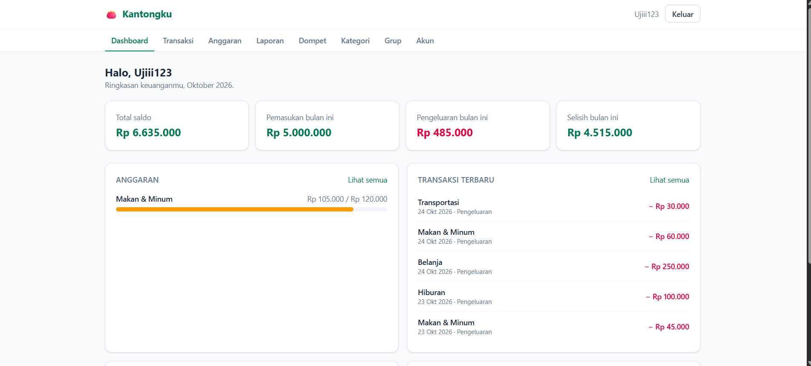
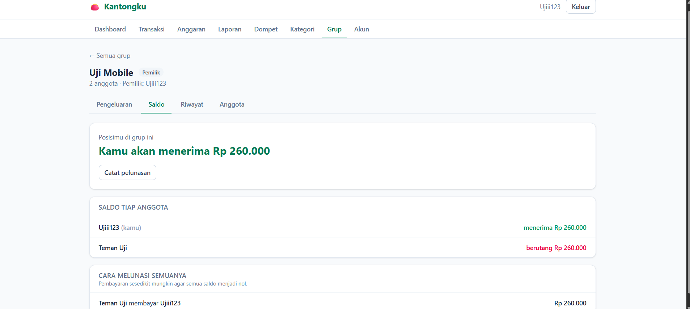
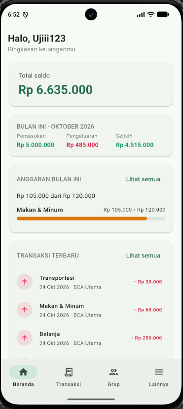
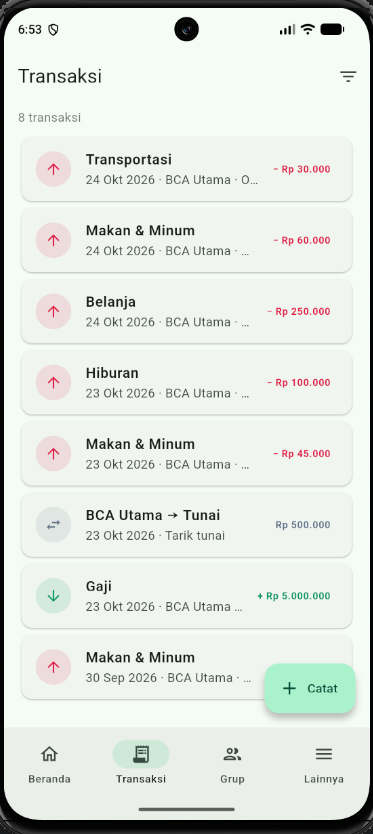
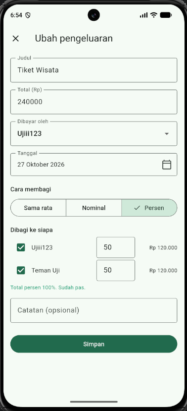
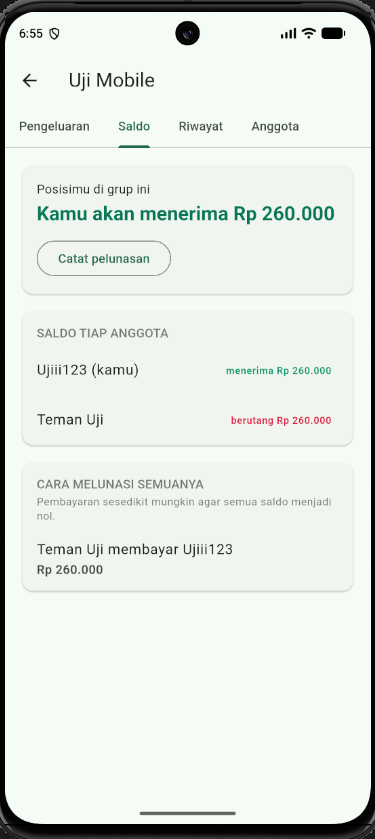

# Kantongku


Aplikasi pencatat keuangan pribadi sekaligus alat patungan (split bill) bersama teman. Catat pemasukan dan pengeluaran di beberapa dompet, atur anggaran bulanan, lihat laporan, lalu buat grup untuk membagi pengeluaran bersama dan melacak siapa berutang kepada siapa. Tersedia sebagai aplikasi web (Vue 3) dan aplikasi Android (Flutter) di atas satu REST API Laravel.

## Tampilan

**Web**

<p align="center">
  
  
</p>

**Mobile (Android)**

<p align="center">
  
  
  
  
</p>

## Fitur

**Keuangan pribadi**
- Banyak dompet (tunai, bank, e-wallet); saldo dihitung dari riwayat transaksi, bukan disimpan
- Pemasukan, pengeluaran, dan transfer antar dompet, lengkap dengan kategori
- Daftar transaksi dengan pencarian, filter, dan paginasi
- Anggaran bulanan per kategori dengan realisasi dan penanda melebihi batas
- Dashboard ringkasan bulan berjalan, laporan bulanan, grafik harian, dan ekspor CSV (web)
- Pengaturan akun: ubah profil dan kata sandi

**Patungan**
- Grup dengan kode undangan; pemilik dan anggota punya hak akses berbeda
- Pengeluaran bersama dengan tiga mode pembagian: sama rata, nominal, dan persen
- Saldo tiap anggota dan penyederhanaan utang (siapa membayar siapa, sesedikit mungkin)
- Pencatatan pelunasan dan riwayat grup
- Anggota bisa keluar atau dikeluarkan hanya jika saldonya sudah nol

## Teknologi

| Bagian | Teknologi |
|---|---|
| Backend | Laravel 12, Sanctum (token), MySQL |
| Web | Vue 3, Vite, Tailwind CSS, Pinia, Vue Router, Axios |
| Mobile | Flutter (Android), Dio, Provider, go_router, flutter_secure_storage |
| Pengujian | PHPUnit (98 tes), Flutter test (21 tes), GitHub Actions |

## Struktur repo

```
kantongku/
├── backend/   REST API Laravel
├── web/       Aplikasi web Vue 3
├── mobile/    Aplikasi Android Flutter
├── docs/      SRS, ERD, dan screenshot
└── .github/   Workflow CI
```

Dokumentasi perancangan ada di [`docs/SRS.md`](docs/SRS.md) dan [`docs/ERD.md`](docs/ERD.md). Panduan khusus tiap aplikasi ada di [`web/README.md`](web/README.md) dan [`mobile/README.md`](mobile/README.md).

## Menjalankan

### Backend

Prasyarat: PHP 8.2+, Composer, MySQL.

```bash
cd backend
composer install
cp .env.example .env
php artisan key:generate
```

Buat database `kantongku` di MySQL, sesuaikan `DB_*` di `.env`, lalu:

```bash
php artisan migrate
php artisan serve
```

API tersedia di `http://127.0.0.1:8000/api`.

### Web

Prasyarat: Node.js 20+ dan backend yang sudah berjalan.

```bash
cd web
npm install
cp .env.example .env   # sesuaikan VITE_API_URL bila perlu
npm run dev
```

Buka `http://localhost:5173`.

### Mobile

Prasyarat: Flutter SDK, Android Studio dengan emulator (atau ponsel Android), dan backend yang sudah berjalan.

```bash
cd mobile
flutter pub get
flutter run
```

Emulator Android mengakses komputer host lewat `10.0.2.2`, dan itu alamat bawaan aplikasi. Untuk ponsel sungguhan dalam satu jaringan Wi-Fi dengan komputer, jalankan backend dengan `php artisan serve --host=0.0.0.0`, lalu:

```bash
flutter run --dart-define=API_URL=http://192.168.x.x:8000/api
```

## Pengujian

Tes backend berjalan di database MySQL terpisah agar data pengembangan tidak tersentuh. Buat database kosong bernama `kantongku_test` (tabelnya dibuat otomatis), lalu:

```bash
cd backend
php artisan test
```

Cakupan tes backend: autentikasi, dompet dan perhitungan saldo, transaksi, anggaran, laporan dan ekspor CSV, alur grup (keanggotaan, hak akses, privasi antargrup), tiga mode pembagian pengeluaran, penyederhanaan utang, pelunasan, dan aturan keluar grup.

Untuk mobile:

```bash
cd mobile
flutter analyze
flutter test
```

Ketiga bagian dijalankan otomatis di GitHub Actions: **Backend Tests** (PHPUnit dengan MySQL 8), **Web Build** (`npm run build`), dan **Mobile Checks** (`flutter analyze` dan `flutter test`).

## Keputusan desain

- Semua nominal disimpan sebagai bilangan bulat rupiah (tanpa desimal) agar bebas galat pembulatan.
- Saldo dompet dihitung dari saldo awal dan riwayat transaksi, bukan disimpan sebagai kolom, sehingga tidak bisa menyimpang dari datanya.
- Sisa pembulatan saat membagi pengeluaran dibebankan ke pembayar, sehingga jumlah porsi selalu sama persis dengan total.
- Penyederhanaan utang memakai algoritma greedy: pelunas terbesar dipasangkan dengan penerima terbesar. Hasilnya paling banyak n−1 pembayaran untuk n anggota dan semua saldo menjadi nol, tetapi jumlahnya tidak dijamin minimum global (masalah itu jauh lebih sulit dan tidak diperlukan untuk grup kecil).
- Data pengguna terisolasi: sumber daya milik pengguna lain dijawab 404, bukan 403, supaya keberadaannya tidak bocor.
- Tabel grup bernama `split_groups` karena `groups` adalah kata cadangan di MySQL.
- Tes backend memakai MySQL sungguhan (bukan SQLite) agar perilakunya sama dengan produksi, dengan pengaman yang menolak menjalankan tes di database yang namanya tidak berakhiran `_test`.
- Di mobile, token disimpan di penyimpanan aman perangkat (Keystore Android), bukan teks biasa.

## Lisensi

[MIT](LICENSE)