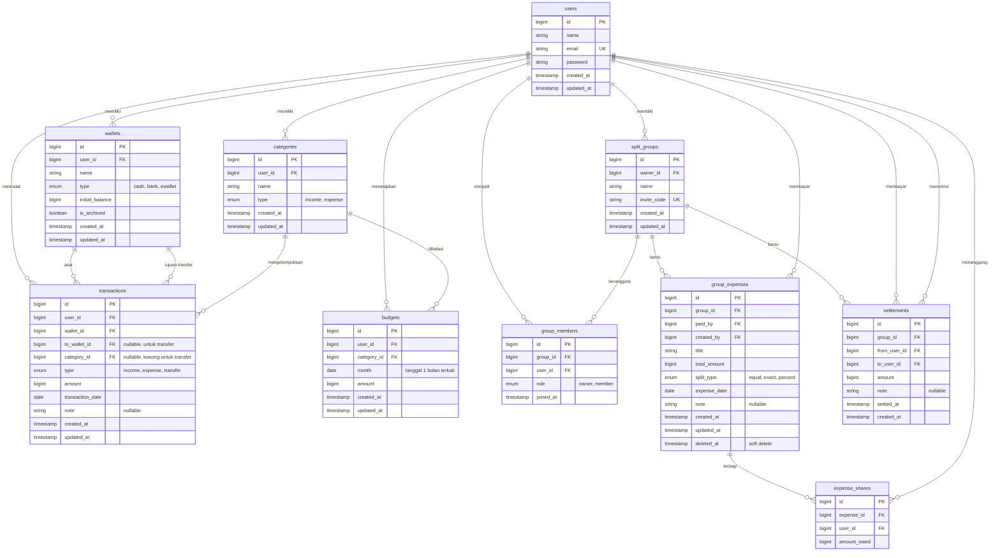

# docs/ERD.md

# Entity Relationship Diagram (ERD)
## Kantongku

Dokumen ini menjelaskan struktur basis data Kantongku (MySQL 8). Seluruh nominal uang bertipe `bigint` dalam rupiah. Saldo dompet tidak disimpan, melainkan dihitung dari `initial_balance` ditambah transaksi. Nama tabel `split_groups` dipakai karena `groups` adalah kata cadangan di MySQL 8.

## Diagram

## Daftar Tabel

| Tabel | Fungsi |
|---|---|
| `users` | Akun pengguna |
| `wallets` | Dompet milik pengguna (tunai, bank, e-wallet) |
| `categories` | Kategori pemasukan/pengeluaran milik pengguna |
| `transactions` | Pemasukan, pengeluaran, dan transfer antar dompet |
| `budgets` | Anggaran bulanan per kategori pengeluaran |
| `split_groups` | Grup patungan beserta kode undangan |
| `group_members` | Keanggotaan pengguna di grup dan perannya |
| `group_expenses` | Pengeluaran bersama dan siapa pembayarnya |
| `expense_shares` | Porsi tanggungan tiap anggota atas satu pengeluaran bersama |
| `settlements` | Catatan pelunasan utang antaranggota |

## Aturan dan Indeks

- `users.email` unik.
- `categories`: unik pada (`user_id`, `name`, `type`).
- `budgets`: unik pada (`user_id`, `category_id`, `month`).
- `group_members`: unik pada (`group_id`, `user_id`).
- `split_groups.invite_code` unik.
- `transactions`: indeks pada (`user_id`, `transaction_date`) dan (`wallet_id`).
- `expense_shares`: unik pada (`expense_id`, `user_id`); jumlah `amount_owed` per pengeluaran harus sama dengan `total_amount`.
- `transactions.type = transfer` mewajibkan `to_wallet_id` terisi, `category_id` kosong, dan dua dompet berbeda.
- `settlements`: `from_user_id` tidak boleh sama dengan `to_user_id`, dan `amount` lebih dari nol.
- `group_expenses` memakai soft delete agar riwayat dan saldo dapat ditelusuri.

## Rumus Saldo Anggota dalam Grup

Saldo bersih seorang anggota dihitung dari: total `total_amount` pengeluaran yang ia bayar, dikurangi total `amount_owed` miliknya, ditambah total pelunasan yang ia bayarkan, dikurangi total pelunasan yang ia terima. Saldo positif berarti ia masih harus menerima uang, saldo negatif berarti ia masih berutang. Jumlah saldo seluruh anggota dalam satu grup selalu nol.
